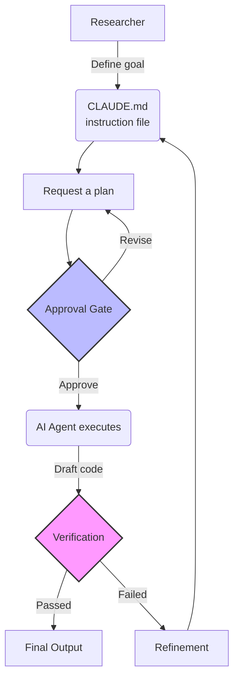

:::::::::::::::::::::::::::::::::::::::: questions

- What can each kind of AI tool see, and what can it change?
- Why use a command-line tool for this lesson?
- What goes in a project instruction file, and what does it not do?

::::::::::::::::::::::::::::::::::::::::::::::::::

::::::::::::::::::::::::::::::::::::::: objectives

- Describe what an AI tool can read and change in your configuration.
- Show the working directory, the files an agent can see and one change as a diff.
- Create a short instruction file (`CLAUDE.md`) with a source-backed constraint and a check you can run.

::::::::::::::::::::::::::::::::::::::::::::::::::

::::::::::::::::::::::::::::::::::::::::: instructor

## Setup check

A version number confirms the executable. It does not confirm that learners can use the tool. Ask every learner to check five things:

```bash
claude --version
python --version
ls data/
```

- Python runs and imports `pandas`.
- The three input files are listed.
- The account works and one read-only agent action succeeds (the `claude -p` check below).
- Everyone selected the same available model with `/model`. Record the resolved model name, the tool version and the relevant settings. An identical selection does not guarantee identical output.

A learner without an account uses the saved-output route. It has the same terminal and Python files, with saved plans, diffs and command transcripts, and the same approval decisions and tests.

::::::::::::::::::::::::::::::::::::::::::::::::::

## Why a command-line tool for this lesson

An agent in your terminal works with files, commands, output and diffs in one place. That is why this lesson uses one. You can see which folder it works in, what it ran and what it changed.

The reason is visibility for learning, not capability. Browser and editor assistants increasingly offer connectors, file upload and coding features of their own. What an AI tool can do depends on its configured tools, integrations and permissions, and not on its category. Check the actual configuration of the tool in front of you.

If you have not used a command-line agent before, you are in good company. A survey of 868 scientists who program (a 2025 preprint, revised in 2026) found that browser-based chat tools made up most primary tool choices, and command-line or agentic tools a small minority ([O'Brien et al.][obrien-2026]).

A command-line interface (CLI) agent runs in your terminal, where you run Python scripts and move around with `ls` and `cd`. In your configured setup it can:

- Read your files and data, inspect the directory structure and write scripts to disk. You do not copy and paste between a chat window and an editor.
- Call software you have installed, such as GDAL, R packages or your own scripts.
- See an error in the terminal and try again.

## What the tool can see, and what it can change

Before you trust an AI tool, ask what it can see and what it can do. More access helps more, and gives it more chances to go quietly wrong. These kinds of tools sit along that range.

| Tool type | What context it has | What it can do | What can go wrong | What to verify |
|---|---|---|---|---|
| Chatbot | What you paste in, plus any files or connectors you enable | Suggests code and text | May guess your file structure; you copy code by hand | That the code matches your actual columns and files |
| IDE assistant | The open file, sometimes nearby files | Suggests and inserts code inline | Sees part of the project; may fit the line and miss the goal | That the suggestion does what you intended |
| CLI agent | Your project folder, as configured | Reads files, runs code, writes scripts | Can edit or delete real files; can act on a misread of your data | What it read, changed and ran, before you approve |
| Multi-step agent workflow | Whatever you grant, across many steps | Plans and runs a chain of actions | Errors compound; hard to see where it went wrong | That you can explain each step and reproduce the result |

Further down the table, the tool can do more for you and more to you. Nothing in the table removes your responsibility to understand the result.

::::::::::::::::::::::::::::::::::::::::: instructor

## Instructor note: access is not understanding

Learners are often impressed that an agent can read their files and run their code. Impressive access is not a correct result. Watch for learners who can say what the agent can do but not what it just did.

Before a learner approves a command that changes files, ask them to say aloud what the agent read, what it will change and why. If they cannot, slow down.

::::::::::::::::::::::::::::::::::::::::::::::::::

::::::::::::::::::::::::::::::::::::::::: caution

## Data privacy and institutional context

Use only the supplied synthetic data in this workshop. Do not read permission for institutional research data into a personal subscription or into the name of a campus-approved product.

Your institution decides which AI tools may touch which kinds of data. At UCLA, consult [the current campus tool comparison][ucla-ai-tools] for eligibility, price and data classifications. Approved access is tied to a UCLA account and a specific service. UCLA's footnote says P1 to P3 data are allowed in a UCLA account, and P4 data need approval from the Unit Head and the CISO. UCLA's [AI use guide][ucla-ai-guide] also names data that must not go into AI tools unless approved in a secure environment, such as FERPA records, health data, personnel data and unpublished research. Send questions to `grc@ucla.edu`.

Use a backend with sensitive data only after the responsible campus or unit authority confirms the specific account, configuration and data category. A tool that can run on a given cloud service is not thereby approved for sensitive data. Consult your campus data policy before you use any AI tool with restricted data, including protected health information.

If your research needs fully local processing, these skills transfer to open-weight models run on your own machine. Check the licence and the exact version first. Hardware needs depend on the model and the speed you want, so test your chosen configuration.

::::::::::::::::::::::::::::::::::::::::::::::::::

## From writer to active reviewer

People sometimes describe this shift as moving from "writer" to "orchestrator", as if the AI does the work and you conduct. That picture misleads a learner.

AI can reduce the need to remember every detail of syntax. It increases the need to understand intent, dependencies, assumptions, tests and failure modes. You do not hand off the thinking. You move your effort from typing toward reading, questioning and judging. That is harder to do well.

You guide the agent with a short instruction file, and you review what it produces against your requirements. The diagram shows the loop. You state the goal, the agent proposes a plan, you approve it before any code is written, and you verify the result before it counts as done.



*Description of the diagram: a loop. The researcher defines a goal in `CLAUDE.md`, and the agent proposes a plan. The researcher approves the plan or sends it back at an approval gate. Only after approval does the agent draft code. The code then passes a verification step or returns for refinement.*

::::::::::::::::::::::::::::::::::::::::: instructor

## Discussion prompt

Ask learners whether they have used a chatbot to write code that looked right and failed when they ran it. Use their answers to show that the goal is to check the AI's intent against yours, and not only to fix code.

::::::::::::::::::::::::::::::::::::::::::::::::::

Reviewing generated code adds verification load. You check the agent's actions against your requirements.

::::::::::::::::::::::::::::::::::::::::: callout

## Managing cognitive load

You may feel out of the loop when an AI writes many lines quickly. Anchor your understanding. Read the comments it generates, and test small pieces often. If a block is confusing, ask the AI to explain it before you move on.

::::::::::::::::::::::::::::::::::::::::::::::::::

::::::::::::::::::::::::::::::::::::::::: caution

## Security responsibility

Starting an agent in your project folder sets its working context. It does not on its own create a security boundary. Inspect what the agent can actually read, write and reach over the network, and which integrations are on.

A buggy or misconfigured agent could delete files or reach sensitive data such as passwords. Keep your files backed up or under version control (such as Git) so you can revert a change.

::::::::::::::::::::::::::::::::::::::::::::::::::

### Long context

A model has limited working memory. In LLM tools this is the context window. Current models have long windows, but a large window does not mean the agent should load your whole project. A better pattern has the agent open the files it needs, within the access you configured.

::::::::::::::::::::::::::::::::::::::::: callout

## A large context window is not a free pass

The more you load into a session, the more the model has to track. Past some point quality can fall. The model may lose earlier instructions, produce inconsistent output or fixate on the wrong files. Choosing what goes into the context is part of the workflow.

::::::::::::::::::::::::::::::::::::::::::::::::::

## Let's make sure this works

Open a terminal and type `claude --help`. This lists the command-line flags. Use the in-session help for interactive commands. Claude Code starts an interactive session by default. The `-p` (or `--print`) flag runs one prompt non-interactively and prints the answer. We use it for quick checks.

Go to your project folder and run a read-only check:

```bash
cd coastal-water-quality
pwd
claude -p "What operating system am I on? List the files here and in data/."
```

Compare the answer with what `ls` and `ls data/` show. Did the AI describe your project accurately? It should return something like:

```
You are on macOS (Darwin). This looks like a data-cleaning project.
Top level: README.md, CLAUDE.example.md, validate_data.py, data/, expected_outputs/
data/: site_A.csv, site_B.csv, site_C.csv
```

Note three things: the folder where you started (`pwd`), the files the agent could see, and whether it changed anything. It should not have changed anything.

### A first look at the data

Look at the data yourself before the agent touches anything:

```bash
head data/site_A.csv
```

Then ask the agent to describe the same file and compare:

```bash
claude -p "Describe the columns in data/site_A.csv and note anything inconsistent or risky for analysis."
```

Did its description match what `head` showed? Where it added an interpretation, such as a guess at what a column means, treat that as the agent's assumption and not as fact. Checking what the tool claims against the data is the habit this lesson builds.

::::::::::::::::::::::::::::::::::::::::: callout

## Working directory matters

Start Claude Code from inside your project folder. The agent uses the current directory to find your files and instructions. Starting from the wrong folder, such as your home folder, is a common source of confusion.

::::::::::::::::::::::::::::::::::::::::::::::::::

### Create the instruction file

Claude Code has an `/init` command. It creates a `CLAUDE.md` file that describes your project. Run it once, here.

```bash
claude
```

You are now in a Claude Code session. Type `/` to see the slash commands. Run:

```bash
/init
```

Watch what it inspects. When it finishes, look at what it made. Start a line with `!` to run a shell command inside the session:

```bash
!ls
!cat CLAUDE.md
```

The generated file looks something like this:

```markdown
# CLAUDE.md

## Project Overview

This is a data-cleaning project. The `data/` directory holds three water quality
files (`site_A.csv`, `site_B.csv`, `site_C.csv`) with inconsistent column names and
date formats. The goal is to merge them into `data/master_dataset.csv` and analyse
water quality trends. See `README.md` for the target schema.

## Key Files

- **`data/site_*.csv`**: raw per-site measurements (do not edit).
- **`validate_data.py`**: checks for the merged dataset.
- **`CLAUDE.md`**: project context and rules, loaded automatically each session.
```

The agent scanned the folder and described the real project. You still edit the file by hand to add your goals and constraints. Do not expect `/init` to make the agent more correct. A short file that a person has reviewed makes the agent's instructions easy to audit.

## The instruction file

A CLI agent can load a project instruction file at the start of a session. For Claude Code that file is `CLAUDE.md`, and this lesson uses it.

Other tools use other conventions. Check what your tool actually loaded:

- Recent Claude Code versions can also load `AGENTS.md`, depending on version and settings. `CLAUDE.md` is the file this lesson supports. An explicit `@AGENTS.md` import in `CLAUDE.md` still helps portability.
- Codex CLI uses `AGENTS.md`. Check the official documentation for the current behaviour.
- Cursor supports scoped rules in `.cursor/rules` and `AGENTS.md`. `.cursorrules` is the older form.
- Gemini CLI uses `GEMINI.md` by default, and the file names are configurable.

A tool that does not load a file will not read it unless you say so: "Read AGENTS.md and then..."

### What to put in the file

- The current goal.
- Technical constraints, such as "use `pandas` for dataframes."
- Source facts the data documentation states, such as a site's date format.
- How you will check that the work is correct.

A requirement in this file is a request to the model. It is not an enforced boundary. Tool permissions and isolation enforce access limits. Your checks test the result.

::::::::::::::::::::::::::::::::::::::::: callout

## Keep a short record of constraints and decisions

A model does not carry your project's rules from one session to the next. Keep your constraints and decisions in plain files that live with the project, so people can inspect them:

- `CLAUDE.md` holds durable rules, goals and constraints, and loads each session.
- `PLAN.md` holds the plan for one task. You meet it in the next episode.
- A dated notes file holds what you tried, what worked and why you chose it.

For research, the notes file is provenance. It lets you, a reviewer or your future self rebuild what happened. Version control makes the record reviewable. This does not guarantee that the model follows every instruction. Your checks do that job.

::::::::::::::::::::::::::::::::::::::::::::::::::

::::::::::::::::::::::::::::::::::::::::: challenge

## Challenge: add a constraint and a check

Open the `CLAUDE.md` that `/init` created. Add two things:

1. One constraint taken from the data documentation. For example: "Site C dates are day-month-year. Parse them explicitly."
2. One check you could run to see whether the constraint was met. For example: "After cleaning, SC001 must have the date 2023-01-05."

Then show one change as a diff. Ask the agent to add a line to `CLAUDE.md`, and compare the file before and after (for example with `git diff` or `diff`). Which line changed?

:::::::::::::::::::::::::::::::::::::::: solution

## Example

```markdown
# Project: Coastal Water Quality Trends

## Goal
Clean and merge three site files into data/master_dataset.csv, then plot score
over time by site.

## Rules
- Use pandas for data and matplotlib for plots.
- Site C dates are day-month-year (05-01-2023 is 5 January). Parse them explicitly.
- Fill a missing score with the median of that site's observed scores.
- Do not edit data/site_*.csv. Do not drop rows. The merge has 60 rows.

## Checks
- SC001 must have the date 2023-01-05 after cleaning.
- python validate_data.py passes.
```

The constraint comes from the source documentation. The check is something you can run. The median rule is this exercise's fixed choice, and a real study would have to justify it.

::::::::::::::::::::::::::::::::::::::::::::::::::

::::::::::::::::::::::::::::::::::::::::::::::::::

:::::::::::::::::::::::::::::::::::::::::: discussion

## Feedback checkpoint: describe the agent's context

Turn to the person next to you and answer aloud: when you ran `/init`, what did the agent look at, and which file did it create? If you are not sure, say so. Paste one surprise into the shared Etherpad. Working alone? Answer aloud to yourself, or write it as a comment at the top of your `CLAUDE.md`. Saying or writing it surfaces the gaps.

::::::::::::::::::::::::::::::::::::::::::::::::::

:::::::::::::::::::::::::::::::::::::::: keypoints

- Ask what an AI tool can see and do, in its actual configuration, before you trust it.
- A CLI agent can read, run and edit your real files, so checking what it changed is part of the work.
- Run `/init` once to create `CLAUDE.md`, then edit it by hand.
- An instruction file records constraints for people and tools to read. It is not an enforced boundary. Tests check the result.
- Check which instruction file your tool loaded before you rely on it.

::::::::::::::::::::::::::::::::::::::::::::::::::
