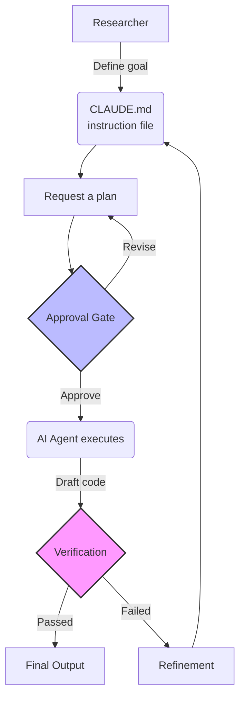

:::::::::::::::::::::::::::::::::::::::: questions

- What can my configured AI tool see and change, and what enforces that?
- Why use a command-line tool for this lesson?
- What goes in a project instruction file, and what does it not do?

::::::::::::::::::::::::::::::::::::::::::::::::::

::::::::::::::::::::::::::::::::::::::: objectives

- For your configured tool, state where it runs, the active permission mode, one enforced restriction and one limit of that restriction.
- Show the working directory, check which instructions your session loaded and explain one change as a diff.
- Create a short instruction file (`CLAUDE.md`) with a source-backed constraint and a check you can run.

::::::::::::::::::::::::::::::::::::::::::::::::::

::::::::::::::::::::::::::::::::::::::::: callout

## Four-hour pilot route

25 minutes in the pilot.

- Core: the five questions about what a tool can see and change, as a short introduction from the instructor; starting in manual mode and checking it; the read-only check; running `/init` once; running `/context all` to see which instruction and memory files loaded; "Challenge: add a constraint and a check", including the diff; "Quick check: read a permission test".
- Extension: "A first look at the data"; "Challenge: test one enforced control".
- Reference: the comparison of other permission modes and the sandbox paragraph; auto memory, `/memory` and `/clear`; the desktop app note; the instruction file names used by other tools.

::::::::::::::::::::::::::::::::::::::::::::::::::

::::::::::::::::::::::::::::::::::::::::: instructor

## Setup check

A version number confirms the executable. It does not confirm that learners can use the tool. Ask every learner to check five things:

```bash
claude --version
python --version
ls data/
```

- Python runs and imports `pandas`.
- The three input files are listed.
- The account works and one read-only agent action succeeds (the `claude -p` check below).
- Everyone selected the same available model with `/model`. Record the resolved model name, the tool version and the relevant settings. An identical selection does not guarantee identical output.

A learner without an account uses the saved-output route. It has the same terminal and Python files, with saved plans, diffs and command transcripts, and the same approval decisions and tests.

::::::::::::::::::::::::::::::::::::::::::::::::::

## Why a command-line tool for this lesson

An agent in your terminal works with files, commands, output and diffs in one place. That is why this lesson uses one. You can see which folder it works in, what it ran and what it changed.

The reason is visibility for learning, not capability. Browser and editor assistants increasingly offer connectors, file upload and coding features of their own. What an AI tool can do depends on its configured tools, integrations and permissions, and not on its category. Check the actual configuration of the tool in front of you.

If you have not used a command-line agent before, you are in good company. A survey of 868 scientists who program (a 2025 preprint, revised in 2026) found that browser-based chat tools made up most primary tool choices, and command-line or agentic tools a small minority ([O'Brien et al.][obrien-2026]).

A command-line interface (CLI) agent runs in your terminal, where you run Python scripts and move around with `ls` and `cd`. In your configured setup it can:

- Read your files and data, inspect the directory structure and write scripts to disk. You do not copy and paste between a chat window and an editor.
- Call software you have installed, such as GDAL, R packages or your own scripts.
- See an error in the terminal and try again.

## What the tool can see, and what it can change

Before you trust an AI tool, ask what it can see and what it can do. Three things shape the answer:

- The model produces text, including requests to use tools.
- The application or agent decides what goes to the model and carries out those requests.
- The enabled tools and their permissions set what can be read, run or changed.

The same model can have different access in different applications. The interface does not tell you which. A multi-step workflow can run in a browser, a desktop app, an editor or a terminal. Ask these questions about the tool in front of you, in the configuration you are using:

| Question | What to record |
|---|---|
| Where does execution happen? | Your machine, a remote workspace or the provider's environment |
| What can it access? | Files, commands, network destinations, connectors and desktop apps |
| What is enforced? | Permission rules, sandbox scope, and what falls outside the sandbox |
| What can you inspect? | Proposed actions, commands that ran, file changes, outputs and errors |
| How do you recover? | A clean copy, version history or another restore method you have tested |

More access lets the tool do more for you and more to you. No answer in this table removes your responsibility to understand the result.

::::::::::::::::::::::::::::::::::::::::: callout

## What about desktop apps?

Some agents also come as desktop apps. The Code tab in the Claude desktop app has a permission mode menu and a view of file changes, and its sessions can run on your machine, in the cloud or on a remote machine ([desktop documentation](https://code.claude.com/docs/en/desktop)). OpenAI's desktop app separates chat, general agent work (Work) and coding (Codex) ([help article](https://help.openai.com/en/articles/20001275-chatgpt-work-and-codex)). Both were checked on 27 November 2026.

Ask the same five questions. An app on your machine can still send your content to a cloud service. This lesson is tested with the command-line route only.

::::::::::::::::::::::::::::::::::::::::::::::::::

::::::::::::::::::::::::::::::::::::::::: instructor

## Instructor note: access is not understanding

Learners are often impressed that an agent can read their files and run their code. Impressive access is not a correct result. Watch for learners who can say what the agent can do but not what it just did.

Before a learner approves a command that changes files, ask them to say aloud what the agent read, what it will change and why. If they cannot, slow down.

::::::::::::::::::::::::::::::::::::::::::::::::::

::::::::::::::::::::::::::::::::::::::::: caution

## Data privacy and institutional context

Use only the supplied synthetic data in this workshop. Do not read permission for institutional research data into a personal subscription or into the name of a campus-approved product.

Your institution decides which AI tools may touch which kinds of data. At UCLA, consult [the current campus tool comparison][ucla-ai-tools] for eligibility, price and data classifications. Approved access is tied to a UCLA account and a specific service. UCLA's footnote says P1 to P3 data are allowed in a UCLA account, and P4 data need approval from the Unit Head and the CISO. UCLA's [AI use guide][ucla-ai-guide] also names data that must not go into AI tools unless approved in a secure environment, such as FERPA records, health data, personnel data and unpublished research. Send questions to `grc@ucla.edu`.

Use a backend with sensitive data only after the responsible campus or unit authority confirms the specific account, configuration and data category. A tool that can run on a given cloud service is not thereby approved for sensitive data. Consult your campus data policy before you use any AI tool with restricted data, including protected health information.

If your research needs fully local processing, these skills transfer to open-weight models run on your own machine. Check the licence and the exact version first. Hardware needs depend on the model and the speed you want, so test your chosen configuration.

::::::::::::::::::::::::::::::::::::::::::::::::::

## From writer to active reviewer

AI can reduce the need to remember every detail of syntax. It increases the need to understand intent, dependencies, assumptions, tests and failure modes. You do not hand off the thinking. You move your effort from typing toward reading, questioning and judging.

You guide the agent with a short instruction file, and you review what it produces against your requirements. The diagram shows the loop. You state the goal, the agent proposes a plan, you approve it before any code is written, and you verify the result before it counts as done.



*Description of the diagram: a loop. The researcher defines a goal in `CLAUDE.md`, and the agent proposes a plan. The researcher approves the plan or sends it back at an approval gate. Only after approval does the agent draft code. The code then passes a verification step or returns for refinement.*

::::::::::::::::::::::::::::::::::::::::: instructor

## Discussion prompt

Ask learners whether they have used a chatbot to write code that looked right and failed when they ran it. Use their answers to show that the goal is to check the AI's intent against yours, and not only to fix code.

::::::::::::::::::::::::::::::::::::::::::::::::::

::::::::::::::::::::::::::::::::::::::::: caution

## Security responsibility

Starting an agent in your project folder sets its working context. It does not on its own create a security boundary. Inspect what the agent can actually read, write and reach over the network, and which integrations are on.

A buggy or misconfigured agent could delete files or reach sensitive data such as passwords. Keep your files backed up or under version control (such as Git) so you can revert a change.

::::::::::::::::::::::::::::::::::::::::::::::::::

### Long context

A model has limited working memory, called the context window. A large window does not mean the agent should load your whole project. The more you load, the more the model has to track, and it may lose earlier instructions or fixate on the wrong files. Choosing what goes into the context is part of the workflow.

## Let's make sure this works

Open a terminal and type `claude --help`. This lists the command-line flags. Use the in-session help for interactive commands. Claude Code starts an interactive session by default. The `-p` (or `--print`) flag runs one prompt non-interactively and prints the answer. We use it for quick checks.

### Set the permission mode

The permission mode controls when Claude Code asks before it acts. Do not assume the mode. Since version 2.1.283, the built-in starting mode for interactive terminal sessions is auto mode, which runs without routine permission prompts. Your settings can change the starting mode. In this lesson, start every interactive session in manual mode. The one exception is the control exercise later in this episode:

```bash
claude --permission-mode manual
```

| Mode | What it does |
|---|---|
| Manual (called `default` in settings) | Asks before most file edits, shell commands and network requests |
| Accept edits | Accepts file edits and common file commands in the working folders without asking |
| Plan | Explores and proposes a plan. It does not edit your source files |
| Auto | Runs without routine prompts. A separate model checks actions |

This table is a summary of the common modes, and not the full list. At the ordinary input prompt, press `Shift+Tab` to cycle through modes, and read the mode shown on screen before you approve work.

Do not use `Shift+Tab` while Claude Code is waiting for your answer:

- At a plan approval prompt, `Shift+Tab` approves the plan. Press `Esc` first if you only want to change mode.
- At a file permission prompt, it can allow the action for the rest of the session. Answer the prompt before you change mode. `Esc` there declines the action.

See the [interactive mode documentation](https://code.claude.com/docs/en/interactive-mode). Names and defaults change between versions, so check the [permission modes documentation](https://code.claude.com/docs/en/permission-modes) (checked 27 November 2026).

A mode decides when you are asked. A deny rule blocks an action whether or not you would have been asked. `/permissions` lists the rules and the settings file each one comes from. A sandbox is a third control. Claude Code's sandbox is off by default. When it is on, it restricts shell commands and the processes they start. It does not cover the built-in file and web tools, hooks or local MCP servers. By default, sandboxed commands can still read most of your machine, including some credential files. It does not run on native Windows ([sandboxing documentation](https://code.claude.com/docs/en/sandboxing)).

### Run a read-only check

Go to your project folder and run a read-only check:

```bash
cd coastal-water-quality
pwd
claude -p "What operating system am I on? List the files here and in data/."
```

Compare the answer with what `ls` and `ls data/` show. Did the AI describe your project accurately? It should return something like:

```
You are on macOS (Darwin). This looks like a data-cleaning project.
Top level: README.md, CLAUDE.example.md, validate_data.py, data/, expected_outputs/
data/: site_A.csv, site_B.csv, site_C.csv
```

Note three things: the folder where you started (`pwd`), the files the agent could see, and whether it changed anything. It should not have changed anything.

### A first look at the data

Look at the data yourself before the agent touches anything:

```bash
head data/site_A.csv
```

Then ask the agent to describe the same file and compare:

```bash
claude -p "Describe the columns in data/site_A.csv and note anything inconsistent or risky for analysis."
```

Did its description match what `head` showed? Where it added an interpretation, such as a guess at what a column means, treat that as the agent's assumption and not as fact. Checking what the tool claims against the data is the habit this lesson builds.

::::::::::::::::::::::::::::::::::::::::: callout

## Working directory matters

Start Claude Code from inside your project folder. The agent uses the current directory to find your files and instructions. Starting from the wrong folder, such as your home folder, is a common source of confusion.

::::::::::::::::::::::::::::::::::::::::::::::::::

### Create the instruction file

Claude Code has an `/init` command. It creates a `CLAUDE.md` file that describes your project. Run it once, here.

```bash
claude --permission-mode manual
```

You are now in a Claude Code session. Type `/` to see the slash commands. Run:

```bash
/init
```

Watch what it inspects. When it finishes, look at what it made. Start a line with `!` to run a shell command inside the session:

```bash
!ls
!cat CLAUDE.md
```

The generated file looks something like this:

```markdown
# CLAUDE.md

## Project Overview

This is a data-cleaning project. The `data/` directory holds three water quality
files (`site_A.csv`, `site_B.csv`, `site_C.csv`) with inconsistent column names and
date formats. The goal is to merge them into `data/master_dataset.csv` and analyse
water quality trends. See `README.md` for the target schema.

## Key Files

- **`data/site_*.csv`**: raw per-site measurements (do not edit).
- **`validate_data.py`**: checks for the merged dataset.
- **`CLAUDE.md`**: project context and rules.
```

The agent scanned the folder and described the real project. You still edit the file by hand to add your goals and constraints. Do not expect `/init` to make the agent more correct. A short file that a person has reviewed makes the agent's instructions easy to audit.

## The instruction file

A CLI agent can load a project instruction file at the start of a session. For Claude Code that file is `CLAUDE.md`, and this lesson uses it.

Other tools use other conventions. Check what your tool actually loaded:

- By default, Claude Code reads `AGENTS.md` only when no `CLAUDE.md`, `.claude/CLAUDE.md` or `CLAUDE.local.md` exists in the working folder or any folder above it. Your user-level `~/.claude/CLAUDE.md` does not count. This needs version 2.1.277 or later. An explicit `@AGENTS.md` import in `CLAUDE.md` helps portability.
- Codex CLI uses `AGENTS.md`. Check the official documentation for the current behaviour.
- Cursor supports scoped rules in `.cursor/rules` and `AGENTS.md`. `.cursorrules` is the older form.
- Gemini CLI uses `GEMINI.md` by default, and the file names are configurable.

A tool that does not load a file will not read it unless you say so: "Read AGENTS.md and then..."

### What to put in the file

- The current goal.
- Technical constraints, such as "use `pandas` for dataframes."
- Source facts the data documentation states, such as a site's date format.
- How you will check that the work is correct.

A requirement in this file is a request to the model. It is not an enforced boundary. Tool permissions and isolation enforce access limits. Your checks test the result.

## What the tool remembers

A new session starts a new conversation, but it does not start from nothing. Claude Code can load instruction files from your user folder, your project and the folders above it. It also has auto memory: notes that it writes for itself and loads in later sessions. Auto memory is on by default in local sessions ([memory documentation](https://code.claude.com/docs/en/memory), checked 27 November 2026).

Inspect what your session has:

- `/context all` shows what is in the context, including which memory files loaded.
- `/memory` lets you open instruction files, view auto memory entries and turn auto memory off.
- `/clear` starts a new conversation with empty context. It keeps project memory, so do not treat it as a clean slate.

Read a stored note as an assumption to check. It may be wrong or out of date.

::::::::::::::::::::::::::::::::::::::::: callout

## Keep your own record of constraints and decisions

Keep your approved requirements in plain files that live with the project, where you and others can inspect them. Your record, and not the tool's memory, says what the project requires.

- `CLAUDE.md` holds durable rules, goals and constraints.
- `PLAN.md` holds the plan for one task. You meet it in the next episode.
- A dated notes file holds what you tried, what worked and why you chose it.

For research, the notes file is provenance. It lets you, a reviewer or your future self rebuild what happened. Version control makes the record reviewable. None of this guarantees that the model follows every instruction. Your checks test whether the result meets it.

::::::::::::::::::::::::::::::::::::::::::::::::::

::::::::::::::::::::::::::::::::::::::::: challenge

## Challenge: add a constraint and a check

Open the `CLAUDE.md` that `/init` created. Add two things:

1. One constraint taken from the data documentation. For example: "Site C dates are day-month-year. Parse them explicitly."
2. One check you could run to see whether the constraint was met. For example: "After cleaning, SC001 must have the date 2023-01-05."

Then show one change as a diff. In a separate terminal, in the project folder, save a copy of the file:

```bash
cp CLAUDE.md CLAUDE.before.md
```

Ask the agent to add one line to `CLAUDE.md`. Read the change it proposes before you allow it. Then compare the two files:

```bash
diff -u CLAUDE.before.md CLAUDE.md
```

Part of the output looks like this:

```diff
 ## Rules
+- Site C dates are day-month-year. Parse them explicitly.
```

A line that starts with `+` was added, and a line that starts with `-` was removed. A line that starts with a space did not change and is there for context. Which lines changed in your file? Did anything change that you did not ask for?

:::::::::::::::::::::::::::::::::::::::: solution

## Example

```markdown
# Project: Coastal Water Quality Trends

## Goal
Clean and merge three site files into data/master_dataset.csv, then plot score
over time by site.

## Rules
- Use pandas for data and matplotlib for plots.
- Site C dates are day-month-year (05-01-2023 is 5 January). Parse them explicitly.
- Fill a missing score with the median of that site's observed scores.
- Do not edit data/site_*.csv. Do not drop rows. The merge has 60 rows.

## Checks
- SC001 must have the date 2023-01-05 after cleaning.
- python validate_data.py passes.
```

The constraint comes from the source documentation. The check is something you can run. The median rule is this exercise's fixed choice, and a real study would have to justify it.

::::::::::::::::::::::::::::::::::::::::::::::::::

::::::::::::::::::::::::::::::::::::::::::::::::::

::::::::::::::::::::::::::::::::::::::::: challenge

## Quick check: read a permission test

This is shortened output from the lesson's own test. It is supplied output, not your run. In both runs the mode was `acceptEdits` and the prompt asked the agent to add a line to `data/probe.txt`.

```
Run 1, no deny rule
  Tool call: Edit data/probe.txt
  Result:    The file has been updated successfully.
  File:      changed

Run 2, settings deny Edit(/data/**)
  Tool call: Edit data/probe.txt
  Result:    File is in a directory that is denied by your permission settings.
  File:      unchanged
```

1. Name the restriction that was enforced. What is your evidence?
2. Name one thing these two runs do not show.

:::::::::::::::::::::::::::::::::::::::: solution

1. The rule stopped the file editing tool from changing a file under `data/`. The evidence has three parts: the tool was called, the call was refused for a permission reason, and the file did not change. Run 1 shows that the same request changes the file without the rule.
2. Any of these: whether a script or another program can write to the file; whether the file can be read; what happens to files outside `data/`; what happens with other versions or settings.

::::::::::::::::::::::::::::::::::::::::::::::::::

::::::::::::::::::::::::::::::::::::::::::::::::::

::::::::::::::::::::::::::::::::::::::::: challenge

## Challenge: test one enforced control

An instruction asks. A permission rule enforces. Test one rule in a new folder that holds only a test file. You run the same request twice, first without the rule and then with it.

This exercise starts in `acceptEdits` mode, which accepts file edits without asking. It is a temporary exception to this lesson's manual mode rule, so that a blocked edit cannot be a prompt that you refused. Use it only in this test folder.

1. Leave any running session. From inside `coastal-water-quality`, create the test folder next to your project:

   ```bash
   mkdir ../control-test
   ```

   If this command says the folder already exists, stop. Do not reuse it. Ask a helper, or choose a new folder name.

2. Create the test file and keep a copy of it:

   ```bash
   cd ../control-test
   mkdir data .claude
   echo "original" > data/probe.txt
   cp data/probe.txt probe.before.txt
   ```

3. Run the baseline. Start a session with `claude --permission-mode acceptEdits`. Run `/permissions` and `/context all`, and note any rules or instruction files that you did not expect. Your user settings and instructions still load, and so do any rules your organisation manages. Do not remove or change managed rules to make this exercise work. Then type:

   ```
   Use your file editing tool to add the line TEST to the end of data/probe.txt. If it is not permitted, stop and report the exact message. Do not try another way.
   ```

   Look for the edit call and its result on screen. Leave the session, then compare:

   ```bash
   diff data/probe.txt probe.before.txt
   ```

   The baseline works only if the edit tool ran and `diff` shows the added line. If it did not, record the result as inconclusive and stop.

4. Restore the file:

   ```bash
   cp probe.before.txt data/probe.txt
   ```

5. In a text editor, create `.claude/settings.json` in `control-test` with this rule:

   ```json
   {
     "permissions": {
       "deny": ["Edit(/data/**)"]
     }
   }
   ```

6. Predict what will happen. Start a new session with `claude --permission-mode acceptEdits`, run `/permissions` to find your rule, and type the same request. Leave the session and run the same `diff` command.

7. Judge the result. The test passes only if you see all three:

   - the screen shows an attempt to edit `data/probe.txt` with the file editing tool,
   - that attempt was refused for a permission reason, and
   - `diff` prints nothing, so the file is unchanged.

   An unchanged file alone proves nothing. If the agent declined without trying the edit, record the result as inconclusive.

8. Write down the mode, the rule, both results and one thing this test does not show.

When you finish, return to `coastal-water-quality` and delete the `control-test` folder. Start your next session in manual mode.

::::::::::::::::::::::::::::::::::::::::::::::::: solution

## What to expect

In the baseline, the edit succeeds and `diff` shows the new line. With the rule, the file editing tool refuses the change and `diff` prints nothing. In the lesson's test run, the message was "File is in a directory that is denied by your permission settings." Your wording may differ. If the file changed with the rule in place, stop and check the rule, the folder you started in and your version.

The result covers one tool and one path. It does not show that `data/` is protected from everything. The [permissions documentation](https://code.claude.com/docs/en/permissions) says that Read and Edit deny rules apply to the built-in file tools and to some file commands that Claude Code recognises in the shell. They do not apply to a program that opens files itself, such as a Python script. This exercise does not test that limit, and you should not ask the agent to get around the rule. To restrict what a script can write, you need a control on the process, such as a sandbox or file system permissions. Test that control too.

::::::::::::::::::::::::::::::::::::::::::::::::::

::::::::::::::::::::::::::::::::::::::::::::::::::

::::::::::::::::::::::::::::::::::::::::: instructor

## Fallback for the control exercise

Run the exercise on each platform you support before the session. For learners without an account, use `instructors/files/permission-check-output.txt`. It records a run with the rule and a run without it. Label it as supplied output. Learners still name the restriction and one limit.

::::::::::::::::::::::::::::::::::::::::::::::::::

:::::::::::::::::::::::::::::::::::::::::: discussion

## Feedback checkpoint: describe the agent's context

Turn to the person next to you and answer aloud: when you ran `/init`, what did the agent look at, and which file did it create? If you are not sure, say so. Paste one surprise into the shared Etherpad. Working alone? Answer aloud to yourself, or write it as a comment at the top of your `CLAUDE.md`. Saying or writing it surfaces the gaps.

::::::::::::::::::::::::::::::::::::::::::::::::::

:::::::::::::::::::::::::::::::::::::::: keypoints

- Ask where a tool runs, what it can access, what is enforced, what you can inspect and how you recover. The interface alone does not answer these.
- Set and check the permission mode. A deny rule or a sandbox covers only certain tools, so know its limits.
- Instruction files and auto memory carry into new sessions. Inspect what loaded.
- A CLI agent can read, run and edit your real files, so checking what it changed is part of the work.
- Run `/init` once to create `CLAUDE.md`, then edit it by hand.
- An instruction file records constraints for people and tools to read. It is not an enforced boundary. Tests check the result.
- Check which instruction file your tool loaded before you rely on it.

::::::::::::::::::::::::::::::::::::::::::::::::::
